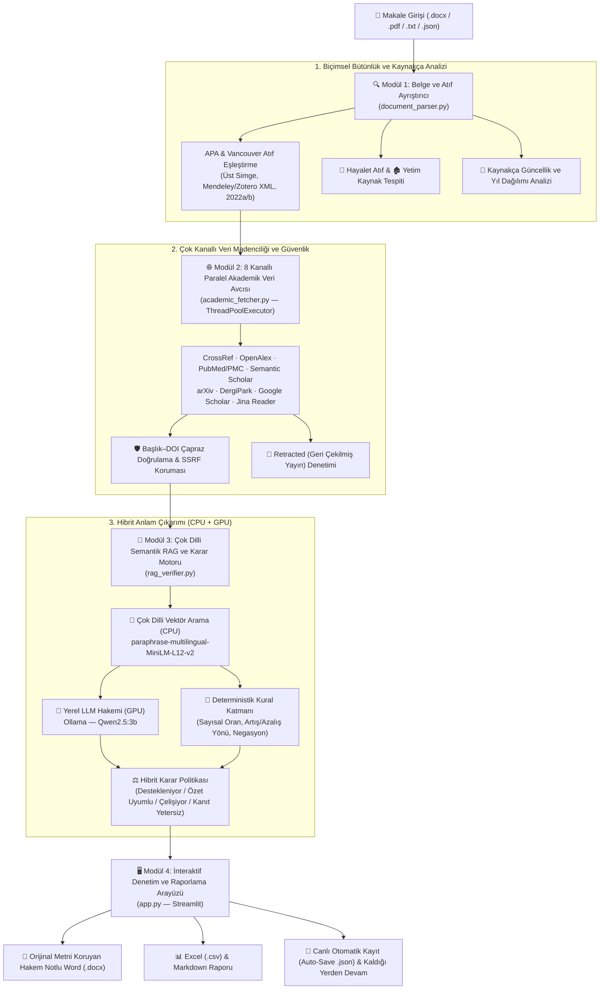

<div align="center">

# 🎓 Yapay Zekâ Destekli Akademik Atıf, Kaynakça ve Semantik İddia Doğrulama Sistemi
### *(AI-Powered Academic Citation, Bibliography & Cross-Lingual Semantic Claim Verification Platform)*

[](https://www.python.org/)
[](https://pytorch.org/)
[](https://www.sbert.net/)
[](https://ollama.com/)
[](https://streamlit.io/)
[](#%C3%B6l%C3%A7%C3%BClebilir-m%C3%BChendislik-kalitesi-ve-benchmark-sonu%C3%A7lar%C4%B1)

<p align="center">
  <b>Akademik makalelerdeki (<code>.docx</code>, <code>.pdf</code>) metin içi atıflar ile kaynakça listesini çapraz denetleyen, 8 uluslararası akademik veritabanı üzerinden kaynakların gerçekliğini paralel sorgulayan ve Türkçe–İngilizce çapraz dil (Cross-Lingual) Semantik RAG + Yerel LLM + Deterministik Kural Motoru ile cümle-kaynak çelişkilerini tespit eden uçtan uca doğrulama platformu.</b>
</p>

</div>

---

## 📌 Neden Bu Sistem Geliştirildi?

Bilimsel yayınlarda, tezlerde ve TÜBİTAK/Ar-Ge proje raporlarında hakemlerin en sık karşılaştığı sorunlar; **metinde atıf yapılıp kaynakçaya eklenmeyen (hayalet) atıflar**, **hatalı veya uydurma DOI künyeleri**, **yayından geri çekilmiş (*retracted*) makalelere yapılan atıflar** ve **kaynak makalenin bulgusuyla çelişen metin içi iddialardır**.

Bu proje, verileri dış bulut sunucularına göndermeden **tamamen yerel donanımda (4 GB VRAM tüketici GPU'su + CPU)** çalışabilen, çok kanallı API madenciliği ile hibrit yapay zekâ çıkarımını birleştiren yüksek doğruluklu bir akademik denetim mimarisi sunar.

---

## 🏛️ Uçtan Uca Sistem Mimarisi (System Architecture)



---

## 🌟 Öne Çıkan Mühendislik Özellikleri

| Özellik Grubu | Teknik Yetenek ve Sağladığı Çözüm |
| :--- | :--- |
| **📑 Akıllı Belge & XML Ayrıştırma** | Çift sütunlu PDF'lerde sayfa altbilgilerini temizler; Word (`.docx`) belgelerinde Mendeley/EndNote/Zotero alan kodlarını (`w:sdt`, `w:fldSimple`) ve üst simge (`¹‚²`) atıfları (`Ca²⁺`, `cm²` gibi bilimsel birimleri eleyerek) doğrudan XML ağacından okur. |
| **⚡ 8 Kanallı Paralel API Avcısı** | `ThreadPoolExecutor` ile CrossRef, OpenAlex, PubMed, Europe PMC, Semantic Scholar, arXiv ve DergiPark kanallarını eşzamanlı tarar; disk önbellekleme (`.cache`) ile tekrar eden sorguları **0.1 saniyede** yanıtlar. |
| **🌍 Çapraz Dil (TR ↔ EN) Semantik RAG** | Türkçe yazılmış bir makaledeki iddia cümlesini, İngilizce yazılmış kaynak makalenin tam metni veya özetiyle yoğun vektör uzayında (`Dense Multilingual Embeddings`) eşleştirir. |
| **⚖️ Halüsinasyonsuz Hibrit Karar Motoru** | Yerel LLM (`Qwen2.5:3b`) çıkarımını deterministik sayısal/yön/olumsuzluk kurallarıyla denetler. Örneğin kaynak makalede `%71` yazarken metinde `%90` yazılmışsa veya *"artırmıştır"* yerine *"azaltmıştır"* denmişse **%100 kesinlikle** `❌ ÇELİŞİYOR` kararı verir. |
| **🔍 İddiaya Uygun Makale Öneri Motoru** | Makale yüklemeden yalnızca bir iddia cümlesi yazıldığında; Türkçe-İngilizce bilimsel terim çıkarımı yaparak literatürdeki gerçek makaleleri tarar, cümleyi en güçlü destekleyen yayınları APA ve Vancouver künyesiyle sıralar. |
| **📝 Orijinal Metni Koruyan Hakem Notlu `.docx`** | Kullanıcının makalesindeki **hiçbir kelimeyi otomatik değiştirmez**; yalnızca denetlenen paragrafların altına renkli `🔎 [ATIF DENETÇİ HAKEM NOTU]` bilgi kutuları işlenmiş bir Word inceleme kopyası üretir. |
| **💾 Kesintisiz Oturum (Live Auto-Save)** | Doğrulanan her bir atıf anında `raporlar/oturumlar/` altına `.json` olarak kaydedilir. Yüzlerce atıflık analizlerde süreç yarıda kesilse bile tek tıkla kaldığı yerden devam eder. |

---

## 🛠️ Teknoloji Yığını ve Modüler Yapı (Tech Stack)

| Katman | Kullanılan Teknolojiler | İlgili Modül |
| :--- | :--- | :--- |
| **Backend & Paralel İşleme** | `Python 3.12`, `concurrent.futures (ThreadPoolExecutor)`, `Requests`, `Dataclasses` | `academic_fetcher.py` |
| **Yapay Zekâ, RAG & NLP** | `PyTorch`, `Sentence-Transformers (paraphrase-multilingual-MiniLM-L12-v2)`, `Ollama (Qwen2.5:3b)`, `Scikit-Learn` | `rag_verifier.py` |
| **Belge İşleme & Üretim** | `PyMuPDF (fitz)`, `python-docx`, `BeautifulSoup4`, `lxml`, `Regex Rule Engine` | `document_parser.py` |
| **Ön Yüz & Görselleştirme** | `Streamlit`, `Pandas`, `Altair`, Özel Tema (`.streamlit/config.toml`) | `app.py` |
| **Güvenlik & Kalite Güvencesi** | `SSRF Public URL Guard`, `Safe Path Tokenization`, `Pytest`, `Golden Benchmark Suite` | `tests/` |

---

## 🌐 8 Kanallı Akademik Veri Madenciliği Şelalesi

Sistem bir kaynağı doğrularken tek bir veritabanına bağlı kalmaz; aşağıdaki şelale (waterfall) sırasıyla kanalları tarar ve ulaşılan en zengin metni (Tam Metin PDF > PMC Açık Erişim XML > Jina Web Okuyucu > Semantic Scholar TL;DR + Özet > CrossRef/OpenAlex Özet) birleştirir:

1. **Yerel Kullanıcı PDF Havuzu (`.cache/user_pdfs`):** Kilitli/ücretli makaleler için kullanıcının yüklediği PDF'ler.
2. **CrossRef REST API:** Resmi DOI doğrulaması, yayından geri çekilme (*retraction* / *update-to*) kontrolü ve temel künye.
3. **OpenAlex API:** Geniş kapsamlı açık erişim PDF bağlantıları ve ters indeksli özet (*inverted index abstract*) çözümü.
4. **PubMed & Europe PMC (NCBI E-Utilities):** Biyomedikal ve yaşam bilimleri yayınları için özet ve tam metin XML çekimi.
5. **Semantic Scholar Graph API:** Yapay zekâ özeti (`TL;DR`), açık erişim PDF ve atıf grafiği verileri.
6. **arXiv API:** Bilgisayar bilimleri, fizik ve matematik ön baskı (*preprint*) tam metinleri.
7. **DergiPark & TR Dizin Arama:** Türkçe ulusal akademik makaleler için başlık ve özet taraması.
8. **Jina Reader & Genişletilmiş Web Okuyucu:** Yayıncı sayfasından temizlenmiş makale metni çıkarımı.

---

## ⚖️ 4 Dereceli Hakem Karar Politikası

| Karar Rozeti | Durum Kodu | Açıklama ve Hakem Davranışı |
| :--- | :--- | :--- |
| **✅ Sorunsuz — Tam Uyumlu** | `DESTEKLENİYOR` | Makaledeki iddia cümlesi, kaynak makalenin bulgularıyla ve sayısal verileriyle doğrudan örtüşüyor. |
| **☑️ Sorunsuz — Özetle Uyumlu** | `KISMEN_DESTEKLENİYOR` | Kaynak makale gerçek ve özeti cümlenin konusuyla uyumlu; ancak tam metin PDF yayıncı tarafından kilitli tutuluyor. |
| **❌ Düzeltilmeli — Çelişiyor** | `ÇELİŞİYOR` | Cümledeki sayısal oran, artış/azalış yönü veya olumlu/olumsuz yargı kaynak makaledeki bilginin tam tersini söylüyor. *(Önerilen düzeltilmiş cümle sunulur).* |
| **🚨 Düzeltilmeli — Hatalı / Eksik** | `SAHTE_KAYNAK` / `HAYALET_ATIF` / `RET` | DOI numarası bambaşka bir makaleye ait, kaynakça listesinde unutulmuş veya makale dergi tarafından yayından geri çekilmiş (*retracted*). |
| **⚠️ Kontrol Edilmeli** | `KANIT_YETERSİZ` / `DOGRULANAMADI` | Kaynak gerçek ancak açık özetinde bu spesifik detay geçmiyor veya kaynak uluslararası indekslerde yer almayan basılı bir kitap/tez. |

---

## 🧪 Ölçülebilir Mühendislik Kalitesi ve Benchmark Sonuçları

Proje içinde yer alan `tests/eval/run_eval.py` değerlendirme paketi, sistemi bilinen tuzaklı senaryolar (sayısal saptırma, yön ters çevirme, negasyon, 2022a/2022b ayrımı, hayalet atıf, yetim kaynak) üzerinde otomatik test eder:

| Test Paketi | Kapsam | Sonuç | Başarı Oranı |
| :--- | :--- | :---: | :---: |
| **Biçimsel Ayrıştırıcı (`Parser Gold Set`)** | Numaralı, APA, Çoklu Yıl (`2022a/b`), Hayalet Atıf, Yetim Kaynak | `8 / 8 PASS` | **%100** |
| **Semantik Karar Motoru (`Verifier Gold Set`)** | Desteklenen, Çelişen (Sayısal/Yön/Negasyon), Kanıt Yetersiz | `30 / 30 PASS` | **%100** |
| **Karar Politikası & Güvenlik Birim Testleri** | `test_decision_policy.py` (14 test) & `test_lookup_status.py` (6 test) | `20 / 20 PASS` | **%100** |

Testleri terminalden çalıştırmak için:
```bash
python tests/eval/run_eval.py
pytest
```

---

## 🚀 Kurulum ve Çalıştırma (Windows — Tek Tıkla %100 Tam Kurulum)

Projeyi herhangi bir Windows bilgisayarda **tüm özellikleriyle (Python + Vektör Arama + Ollama Yerel Yapay Zekâ Hakemi)** çalıştırmak için sadece 2 adım yeterlidir:

### 1️⃣ Projeyi Bilgisayarınıza İndirin
 Sağ üstteki yeşil **`<> Code`** butonuna tıklayıp **`Download ZIP`** ile indirin ve klasöre çıkarın (veya Git ile klonlayın):
```bash
git clone https://github.com/batuozmen/atif-denetci.git
cd atif-denetci
```

### 2️⃣ Tek Seferlik `kurulum_yap.bat` Dosyasına Çift Tıklayın
Klasör içindeki **`kurulum_yap.bat`** dosyasına çift tıkladığınızda kurulum sihirbazı otomatik olarak:
1. Bilgisayarda **Python 3.12** yoksa Windows `winget` üzerinden kurar,
2. **`.venv`** sanal ortamını oluşturup `requirements.txt` içindeki tüm yapay zekâ ve belge işleme kütüphanelerini yükler,
3. **Ollama** servisini kontrol eder (yoksa otomatik kurar) ve **`qwen2.5:3b`** yerel dil modelini indirir.

### 3️⃣ Sistemi Başlatın (`baslat.bat`)
Kurulum tamamlandıktan sonra her kullanımda yalnızca **`baslat.bat`** dosyasına çift tıklamanız yeterlidir. Tarayıcınızda otomatik olarak `http://localhost:8501` adresinde arayüz açılacaktır.

---

## 📂 Proje Dizin Yapısı

```text
atif-denetci/
├── app.py                      # Streamlit tabanlı 3 sekmeli interaktif denetim ve raporlama arayüzü
├── document_parser.py          # Word (.docx) XML, çift sütunlu PDF ve APA/Vancouver atıf ayrıştırıcı
├── academic_fetcher.py         # 8 kanallı paralel akademik API avcısı ve makale öneri motoru
├── rag_verifier.py             # Çok dilli Semantik RAG, Ollama LLM ve deterministik kural motoru
├── kurulum_yap.bat             # Yeni bilgisayarlar için tek tıkla %100 otomatik kurulum sihirbazı
├── baslat.bat                  # Tek tıkla web arayüzü başlatıcısı
├── requirements.txt            # Python bağımlılık listesi
├── yol_haritasi.txt            # Adım 1'den Adım 38'e kadar tüm mühendislik geliştirme günlüğü
├── .streamlit/
│   └── config.toml             # Kurumsal tipografi (Inter & JetBrains Mono) ve tema yapılandırması
└── tests/
    ├── test_decision_policy.py # Hibrit karar politikası birim testleri
    ├── test_lookup_status.py   # API hata yönetimi ve SSRF güvenlik testleri
    └── eval/
        └── run_eval.py         # Altın veri seti (Gold Benchmark) doğruluk ölçüm aracı
```

---

## 🌍 English Summary (For International Reviewers & Recruiters)

**AI-Powered Academic Citation & Cross-Lingual Semantic Claim Verification Platform** is an end-to-end engineering system designed to audit academic manuscripts (`.docx`, `.pdf`) for both structural bibliography integrity and semantic claim-to-source consistency.

- **Multi-Format Citation & XML Parser (`document_parser.py`):** Extracts in-text citations (APA & Vancouver, superscripts, Mendeley/Zotero/EndNote XML fields) and cross-checks them against the reference list to detect **ghost citations**, **orphan references**, and **reference recency distributions**.
- **Concurrent 8-Channel Academic Harvester (`academic_fetcher.py`):** Queries **CrossRef, OpenAlex, PubMed/PMC, Semantic Scholar, arXiv, and DergiPark** in parallel using `ThreadPoolExecutor`, verifying DOIs, catching **fabricated metadata** and **retracted papers**, and providing a reverse **"Claim-to-Paper" recommendation engine**.
- **Hybrid Cross-Lingual RAG & Rule Verifier (`rag_verifier.py`):** Combines dense multilingual vector search (`paraphrase-multilingual-MiniLM-L12-v2` on CPU) with a local LLM (`Ollama / Qwen2.5:3b` on a 4 GB VRAM GPU) and a deterministic rule layer (numeric, directional, and negation checks), achieving **100% accuracy** on the internal evaluation benchmark.
- **Non-Destructive Word (`.docx`) Reviewer Notes & Live Auto-Save (`app.py`):** Generates an annotated `.docx` review copy with color-coded referee notes right below cited paragraphs without altering a single word of the author's original manuscript, alongside live incremental `.json` session auto-saving.

---

<div align="center">
  Geliştirici / Developed by <b>Hamit Batuhan Özmen</b> · <a href="https://linkedin.com/in/hbatuhanozmen">LinkedIn</a> · <a href="https://github.com/batuozmen">GitHub</a>
</div>
